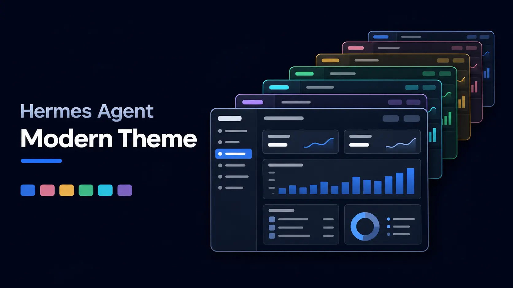

# Hermes Agent Modern Theme



A modern, flat look for the [Hermes Agent](https://hermes-agent.nousresearch.com) web dashboard, in all 26 [Tailwind CSS](https://tailwindcss.com) color palettes.

**[See all 26 themes](https://robertmonroe.github.io/hermes-agent-modern-theme/):** a preview of the dashboard in each theme and the exact colors it uses.

Hermes ships its dashboard with a retro look: pixel display fonts, ALL-CAPS labels, beveled buttons and square boxes. These themes keep everything working the same and change how it looks:

- Geist for all interface text, Geist Mono for code
- Sentence-case labels with normal letter spacing
- Rounded sidebar items with filled hover and active states
- Flat outline buttons, pill-style tab toggles, small rounded badges
- Rounded cards on a slightly lighter surface, hairline borders
- Muted secondary text and a visible focus ring

Only the web dashboard changes. The chat terminal inside it, the CLI and the TUI keep whatever Hermes skin you use.

## The themes

Each palette is its own theme, named `Modern <Palette>`, the same way Hermes ships one theme per look.

**Grays** use the palette's darkest shades for the background, cards and surfaces:
Neutral, Stone, Zinc, Slate, Gray, Mauve, Olive, Mist, Taupe

**Colors** use a near-black background tinted with the color, and the color itself for the active sidebar item, primary buttons, focus rings and text selection:
Red, Orange, Amber, Yellow, Lime, Green, Emerald, Teal, Cyan, Sky, Blue, Indigo, Violet, Purple, Fuchsia, Pink, Rose

## Install

You only need Hermes Agent installed. No restart, no coding.

### 1. Pick a theme

Look through the [theme previews](https://robertmonroe.github.io/hermes-agent-modern-theme/) and note the theme's file name, for example `modern-slate` or `modern-blue`. Every name is `modern-` followed by the palette in lowercase.

### 2. Download it into Hermes

Open a terminal and paste the commands for your system. They find your Hermes folder for you, create a `dashboard-themes` folder inside it if needed, and download the theme there. Replace `modern-slate` (it appears twice) with the theme you picked.

**Windows** (PowerShell):

```powershell
$dir = Join-Path (Split-Path (hermes config path | Select-Object -Last 1)) "dashboard-themes"
New-Item -ItemType Directory -Force $dir | Out-Null
Invoke-WebRequest https://raw.githubusercontent.com/robertmonroe/hermes-agent-modern-theme/main/themes/modern-slate.yaml -OutFile "$dir\modern-slate.yaml"
```

**macOS / Linux** (Terminal):

```bash
dir="$(dirname "$(hermes config path | tail -n 1)")/dashboard-themes"
mkdir -p "$dir"
curl -fsSL https://raw.githubusercontent.com/robertmonroe/hermes-agent-modern-theme/main/themes/modern-slate.yaml -o "$dir/modern-slate.yaml"
```

Want more than one? Run the last line again with another name. Each theme is its own small file.

### 3. Turn it on

1. Open the dashboard. If it isn't running, start it with `hermes dashboard` and open the address it prints (usually http://127.0.0.1:9119).
2. Refresh the page.
3. At the bottom of the left sidebar, click the theme switcher (it shows the name of the current theme, "Hermes Teal" by default).
4. Pick your theme, for example **Modern Slate**.

Or switch from the terminal: `hermes config set dashboard.theme modern-slate`

### Switch back or remove

- **Back to the original look:** choose **Hermes Teal** in the theme switcher.
- **Remove a theme:** delete its `.yaml` file from the `dashboard-themes` folder. `hermes config path` shows where your Hermes folder is; `dashboard-themes` sits next to that `config.yaml`.

### Not working?

- **The theme isn't in the switcher:** refresh the page. If it's still missing, check that the file is in the `dashboard-themes` folder next to the `config.yaml` that `hermes config path` prints, and that its name ends in `.yaml`.
- **Some parts still look old:** do a hard refresh (Ctrl+Shift+R, or Cmd+Shift+R on a Mac).
- **The chat terminal didn't change:** that's expected. These themes style the dashboard only; the chat terminal keeps your Hermes skin.

### Install all 26 at once

Click **Code → Download ZIP** at the top of this page, unzip it, and copy everything in its `themes` folder into your `dashboard-themes` folder. Or, if you have Git and Python 3.9+:

```bash
git clone https://github.com/robertmonroe/hermes-agent-modern-theme
cd hermes-agent-modern-theme
python make_themes.py --install              # all 26
python make_themes.py --install slate blue   # or just these
```
## Customize

| File | What it controls |
|---|---|
| `style.css` | The look shared by every theme: fonts, spacing, shapes, controls |
| `palettes.json` | The colors: every shade of every palette |
| `make_themes.py` | Which shade does which job (background, cards, text, accent), and builds the theme files |
| `tools/import_tailwind.py` | Rebuilds `palettes.json` from a Tailwind CSS v4 `theme.css` |
| `tools/build_page.py` | Rebuilds the colors page in `docs/` from `palettes.json` |

After editing, run `python make_themes.py` to rebuild `themes/` and `python tools/build_page.py` to rebuild the colors page, then `--install` (or copy) the themes you want.

## Compatibility

Built and tested against Hermes Agent v0.23.0. Hermes themes allow raw CSS, and this theme uses it to reach parts of the dashboard that theme colors alone can't change. If a future Hermes release renames those parts, some of the styling may stop applying. The theme still loads, it just looks closer to the default.

## Credits

- Colors: the [Tailwind CSS](https://tailwindcss.com) v4 palette (MIT). Values are converted from Tailwind's OKLCH definitions to hex.
- Fonts: [Geist and Geist Mono](https://vercel.com/font) by Vercel, loaded from Google Fonts.

Not affiliated with or endorsed by Nous Research, Tailwind Labs or Vercel.

## License

MIT. See [LICENSE](LICENSE).
