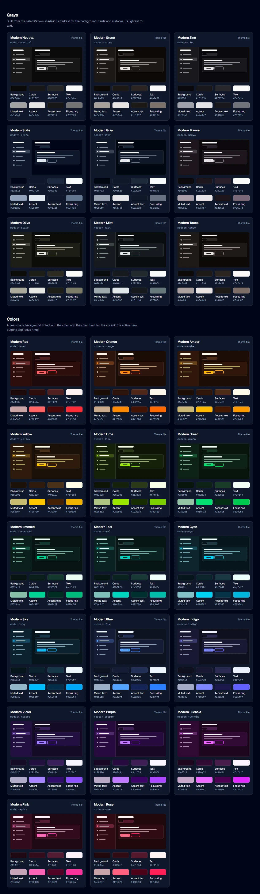

# Theme previews

[](https://robertmonroe.github.io/hermes-agent-modern-theme/)

**[Open the theme page](https://robertmonroe.github.io/hermes-agent-modern-theme/)** for a closer look at each theme.

## How to install a theme

You only need Hermes Agent installed. It takes about a minute.

### 1. Pick a theme

Each card above shows the theme's file name under its title, for example `modern-slate` or `modern-blue`.

### 2. Download it into Hermes

Open a terminal and paste the commands for your system. They find your Hermes folder for you and save the theme there. Replace `modern-slate` (it appears twice) with the theme you picked.

**Windows** (PowerShell):

```powershell
$dir = Join-Path (Split-Path (hermes config path | Select-Object -Last 1)) "dashboard-themes"
New-Item -ItemType Directory -Force $dir | Out-Null
Invoke-WebRequest https://raw.githubusercontent.com/robertmonroe/hermes-agent-modern-theme/main/themes/modern-slate.yaml -OutFile "$dir\modern-slate.yaml"
```

**macOS / Linux** (Terminal):

```bash
dir="$(dirname "$(hermes config path | tail -n 1)")/dashboard-themes"
mkdir -p "$dir"
curl -fsSL https://raw.githubusercontent.com/robertmonroe/hermes-agent-modern-theme/main/themes/modern-slate.yaml -o "$dir/modern-slate.yaml"
```

### 3. Turn it on

1. Open the Hermes dashboard. If it isn't running, start it with `hermes dashboard` and open the address it prints (usually http://127.0.0.1:9119).
2. Refresh the page.
3. At the bottom of the left sidebar, click the theme switcher (it shows the current theme's name, "Hermes Teal" by default).
4. Pick your theme, for example **Modern Slate**.

**To switch back,** pick **Hermes Teal** in the same switcher.

More help, and how to install all 26 at once, is in the [main README](../README.md#install).

---

This folder holds the files for the theme page. The theme files themselves are in [`themes/`](../themes).
